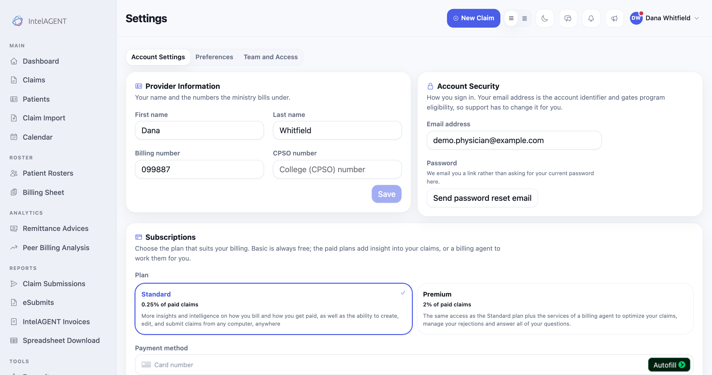
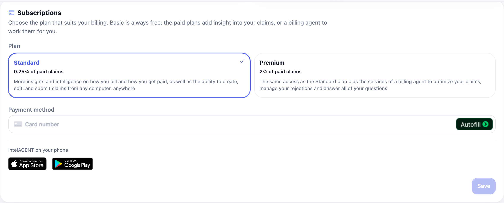
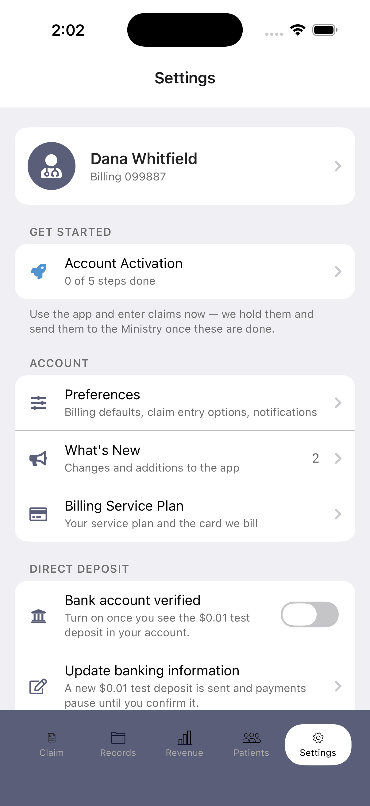
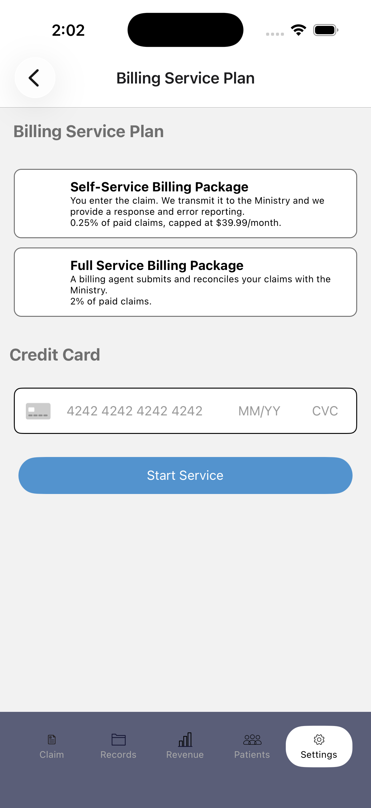
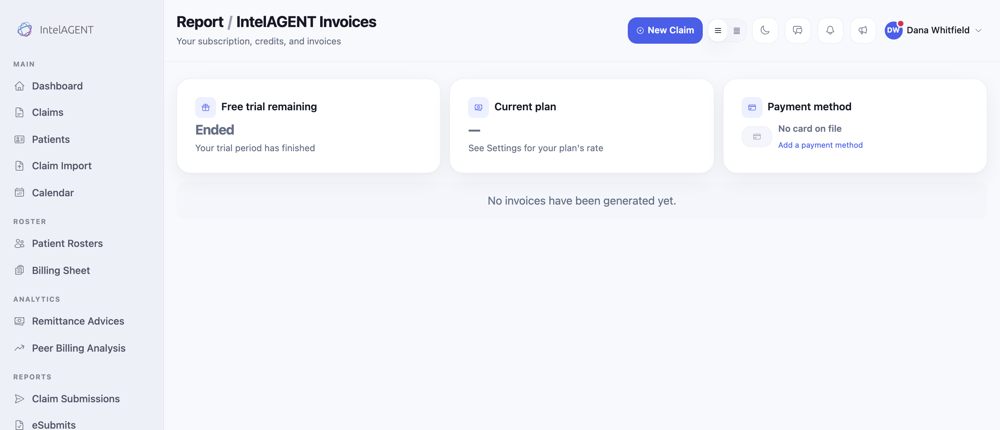

Your subscription is what you pay IntelAGENT — a percentage of the OHIP payments you
actually receive. It is separate from the money OHIP pays you for your claims.

You can subscribe from either app, and whichever you use, it is the same subscription.

| | Where it lives | What it is called |
|---|---|---|
| Web app | Avatar menu (top right) > **Settings** > **Account Settings** > **Subscriptions** | Subscriptions |
| iPhone / iPad | **Settings** > **Billing Service Plan** | Billing Service Plan |
| Android | **Settings** > **Submission Service** | Submission Service |

<Note>
If you bill only through **William Osler Health System**, you are reimbursed by EFT and
there is no subscription to set up. See [WOHS Onboarding](/docs/william-osler/onboarding).
</Note>

## Subscribing from the web app

<Steps>
  <Step title="Open Settings">
    Click your avatar in the top right, choose **Settings**, and stay on the
    **Account Settings** tab. Scroll to the **Subscriptions** card.

    <Frame>
      
    </Frame>
  </Step>
  <Step title="Choose a plan">
    Under **Plan**, pick **Standard** (0.25% of paid claims) or **Premium**
    (2% of paid claims). The chosen plan is outlined and shows a check mark.
    See [Plans & Pricing](/docs/billing/plans-pricing) for what each one includes.
  </Step>
  <Step title="Enter your card">
    Under **Payment method**, type your card number, expiry and CVC. The card is sent
    straight to Stripe — IntelAGENT never sees or stores the full number.

    <Frame>
      
    </Frame>
  </Step>
  <Step title="Save">
    Click **Save**. The confirmation reads **You have been subscribed**.

    **Save** stays disabled until you change the plan or enter a card, so nothing
    happens if you open the card and change nothing.
  </Step>
</Steps>

If you are still going through [Account Activation](/docs/getting-started/onboarding),
the **Subscribe to a plan** step does the same thing — pick a plan, click **Add payment
method**, enter the card and click **Subscribe**.

## Subscribing from the iPhone app

<Steps>
  <Step title="Open Settings">
    Tap **Settings** in the tab bar, then **Billing Service Plan** under **Account**.

    <Frame>
      
    </Frame>
  </Step>
  <Step title="Choose a package">
    Tap **Self-Service Billing Package** (0.25% of paid claims, capped at \$39.99/month)
    or **Full Service Billing Package** (2% of paid claims). The one you pick turns blue
    with a white check mark. If you already have a service, that card is tagged
    **YOUR SERVICE**.
  </Step>
  <Step title="Enter your card">
    Under **Credit Card**, fill in the card number, **MM/YY** and **CVC**.

    <Frame>
      
    </Frame>
  </Step>
  <Step title="Start Service">
    Tap **Start Service**. The confirmation reads **Your billing service is now active**
    and you are returned to Settings.
  </Step>
</Steps>

<Note>
On **Android** the same screen is called **Submission Service**, the rates are not shown
on screen (they are in the [fee schedule](https://www.intelagent.ca/app/terms.html)), and
the button reads **Authorize and save card**. This is a Google Play requirement, not a
different service — the plans and rates are identical.
</Note>

## Changing your plan

Open the same screen, pick the other plan, and save. On the web that is **Save**; on
iPhone it is **Start Service**.

Switching keeps your existing billing cycle — the new rate applies from the switch, and
your billing day does not move.

## Updating the card we bill

Once a card is on file, the web app shows the card's last four digits, its expiry and
when it was last updated, instead of the card field. Click **Edit** next to it (**Edit** on iPhone too) to replace it, enter the new card, and
save. The new card replaces the old one.

There is no "remove card" button. A paid plan always has a card on file; to stop billing
entirely, [contact us](mailto:agent@intelagent.ca).

## Free trial

New OHIP accounts get a **3-month (90-day) free trial**, but it does not start when you
sign up. It is granted automatically once **both** are true:

1. You are subscribed to a plan, and
2. Your MC EDT designation is confirmed — see
   [MC EDT Designation](/docs/getting-started/designation).

That is the same moment your account is activated and your held claims start going to the
Ministry. Nothing is charged until the trial ends.

The trial runs at least 90 days and then extends to the next 17th of the month, so that
when it converts your billing lands on the same day as everyone else's.

Days remaining are shown in two places: a **Free trial** badge at the top of the
**Subscriptions** card, and the **Free trial remaining** tile on the IntelAGENT Invoices
page.

## When you are billed

- Your billing day is the **17th of each month**, not the 1st.
- Each period runs from the 17th to the 17th and is charged in arrears, based on the OHIP
  payments that landed in that period.
- **Standard:** 0.25% of paid claims, capped at \$39.99 per billing period.
- **Premium:** 2% of paid claims, uncapped.

## Finding your invoices

Invoices are not in Settings. Go to **Reports** > **IntelAGENT Invoices** in the left
sidebar.

<Frame>
  
</Frame>

The three tiles across the top show **Free trial remaining**, **Current plan** and
**Payment method**. Below them, each invoice lists:

| Column | What it shows |
|--------|---------------|
| Invoice # | The IntelAGENT invoice number, e.g. `IA-202610-A4F92B` |
| Billing Period | The 17th-to-17th window the fee covers |
| Date | When the card was charged |
| Status | Paid, or refunded |
| Amount | The total charged, including HST |

Click **PDF** on any row to download that invoice. The PDF breaks the total down one
remittance at a time, showing the OHIP payment it was calculated from, the rate, whether
the \$39.99 cap applied, and the HST.

Until your first charge, the page reads **No invoices have been generated yet**. You are
on a trial, or no remittance has arrived yet.

## If a payment fails

Stripe retries a declined card automatically on its own schedule, and emails you when a
charge fails. If it keeps failing:

1. Open **Settings** > **Subscriptions** (web) or **Settings** > **Billing Service Plan**
   (mobile).
2. Click or tap **Edit** next to the saved card.
3. Enter a working card and save.

If you are not sure what went wrong, email [agent@intelagent.ca](mailto:agent@intelagent.ca).

<Note>
IntelAGENT does not email a receipt for a successful charge. Your record of what you paid
is the invoice PDF under **Reports** > **IntelAGENT Invoices**.
</Note>

## Cancelling

There is no cancel button in either app. Email
[agent@intelagent.ca](mailto:agent@intelagent.ca) or use the in-app chat
(**Settings** > **Ask us a question**) and we will close the subscription for you.

Because the fee is charged in arrears, a final invoice usually follows for OHIP payments
that arrived before you cancelled.

## Questions?

For anything about your subscription or an invoice, contact
[agent@intelagent.ca](mailto:agent@intelagent.ca) or use the in-app support chat.
