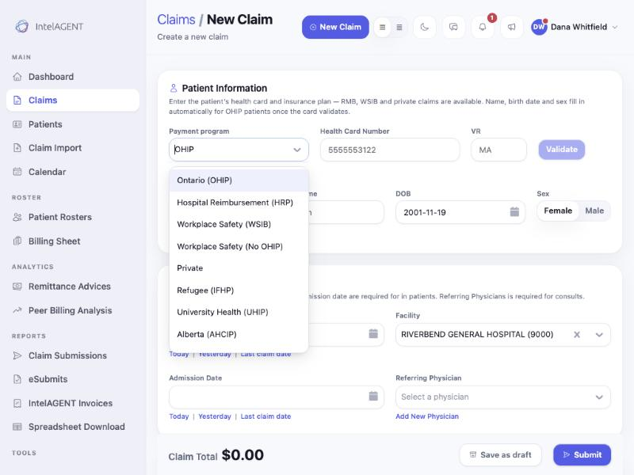
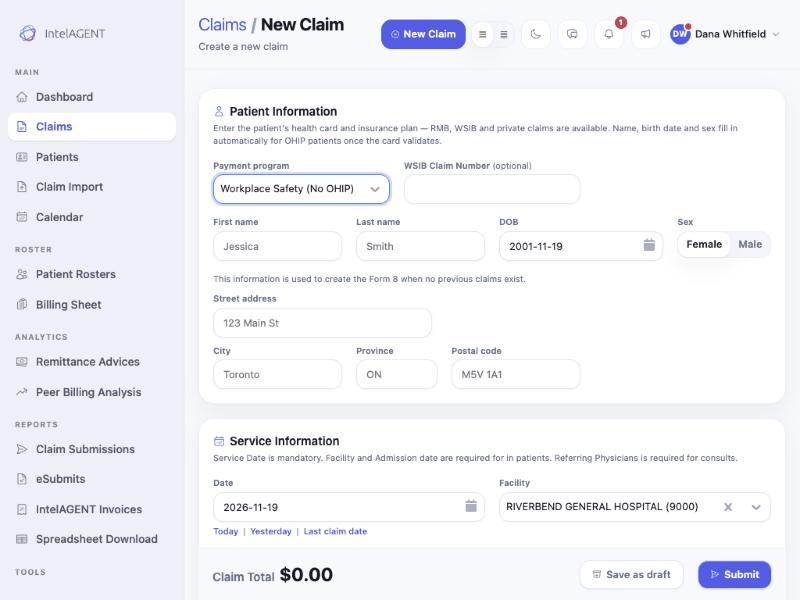
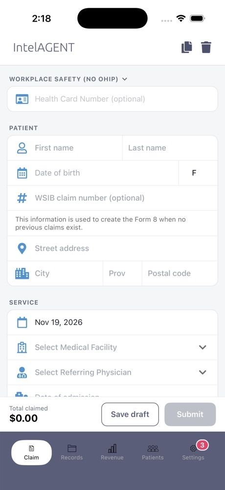
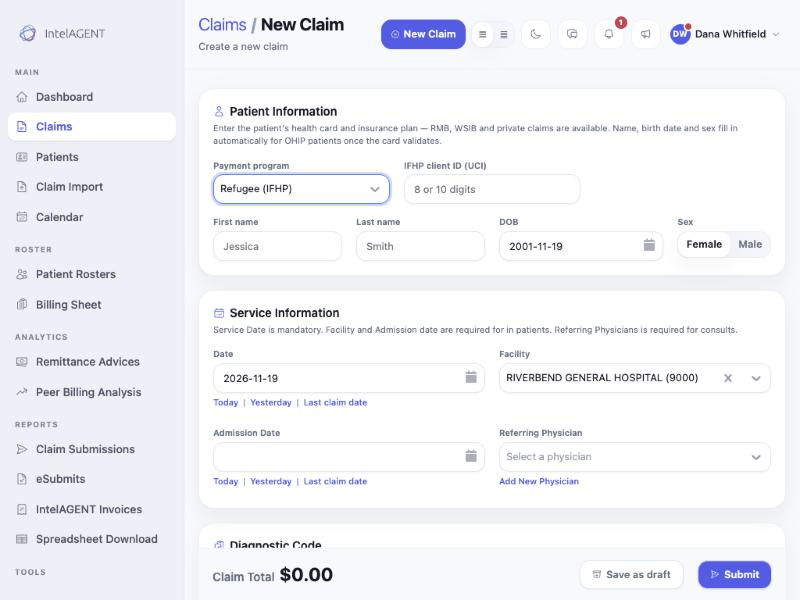
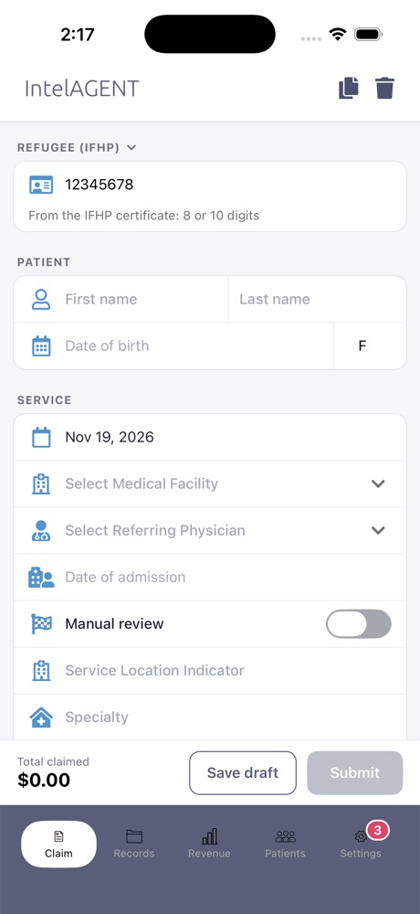

Some claims aren't paid by OHIP at all. A workplace injury that WSIB pays you for
directly, and a refugee patient covered by the Interim Federal Health Program
(IFHP) through Medavie Blue Cross, are both entered the same way as any other
claim. The only difference is the **Payment program** you choose.

<Note>
  You need a WSIB provider number or a Medavie Blue Cross provider number before
  these claims can be paid. See [Federal programs and WSIB](/docs/new-physician/federal-and-wsib)
  to register.
</Note>

## Which program to choose

| The patient is | Payment program |
| --- | --- |
| A worker injured on the job, and WSIB pays you directly | **Workplace Safety (No OHIP)** |
| A worker injured on the job, and the claim goes through OHIP | **Workplace Safety (WSIB)** |
| A refugee or protected person with an IFHP certificate | **Refugee (IFHP)** |

<Warning>
  **Workplace Safety (No OHIP)** and **Workplace Safety (WSIB)** are different
  programs. If WSIB has told you to bill them directly, or the patient has no OHIP
  card, choose **Workplace Safety (No OHIP)**.
</Warning>

## WSIB claims

<Tabs>
  <Tab title="Web app">
    <Steps>
      <Step title="Open a new claim">
        Click **New Claim**, top right of any screen.
      </Step>
      <Step title="Choose Workplace Safety (No OHIP)">
        In **Payment program**, choose **Workplace Safety (No OHIP)**.

        <Frame>
          
        </Frame>
      </Step>
      <Step title="Enter the WSIB claim number, if you have it">
        **WSIB Claim Number** is optional. If it isn't on the patient's forms, leave
        it blank.
      </Step>
      <Step title="Enter the patient's details and address">
        Enter first name, last name, date of birth and sex, then the patient's
        street address, city, province and postal code. When there's no claim
        number yet, this is used to create the Form 8.

        <Frame>
          
        </Frame>
      </Step>
      <Step title="Add the service and submit">
        Add the date of service, facility, diagnostic code and billing codes as
        usual, then click **Submit**.
      </Step>
    </Steps>
  </Tab>
  <Tab title="Mobile app">
    <Steps>
      <Step title="Open Claim">
        Tap **Claim** in the bottom navigation.
      </Step>
      <Step title="Choose Workplace Safety (No OHIP)">
        Tap the payment program name above the health card field, then choose
        **Workplace Safety (No OHIP)**.
      </Step>
      <Step title="Enter the patient's details and address">
        Enter the patient's name, date of birth and sex. **WSIB claim number** is
        optional; leave it blank if you don't have one. Then enter the street
        address, city, province and postal code. When there's no claim number yet,
        this is used to create the Form 8.

        <Frame>
          
        </Frame>
      </Step>
      <Step title="Add the service and submit">
        Add the date of service, facility, diagnostic code and billing codes, then
        tap **Submit**.
      </Step>
    </Steps>
  </Tab>
</Tabs>

### Print the WSIB form

If you'd rather send a claim to WSIB through TELUS Health yourself, you can print
it as a WSIB provider payment request (form 3947A). This is available in the web
app.

<Steps>
  <Step title="Open the claim">
    Open the claim from your **Claims** list.
  </Step>
  <Step title="Click Forms">
    Click **Forms**, top right of the claim. The patient, the service lines and
    your billing details are filled in from the claim.
  </Step>
  <Step title="Download and finish the form">
    Click **Preview** to check it, or **Download form** to save the PDF. Print
    it, complete the sections listed under **Still to complete by hand**, and
    send it to WSIB.
  </Step>
</Steps>

## Blue Cross (IFHP) claims

IFHP patients don't have an OHIP card. Medavie Blue Cross identifies them by the
**IFHP client ID (UCI)** printed on their IFHP certificate. It's 8 or 10 digits.
You can type it with or without the dashes.

<Tabs>
  <Tab title="Web app">
    <Steps>
      <Step title="Open a new claim">
        Click **New Claim**, top right of any screen.
      </Step>
      <Step title="Choose Refugee (IFHP)">
        In **Payment program**, choose **Refugee (IFHP)**. The health card field
        changes to **IFHP client ID (UCI)**.
      </Step>
      <Step title="Enter the UCI and the patient's details">
        Enter the UCI from the IFHP certificate, then first name, last name, date
        of birth and sex.

        <Frame>
          
        </Frame>
      </Step>
      <Step title="Add the service and submit">
        Add the date of service, facility, diagnostic code and billing codes as
        usual, then click **Submit**.
      </Step>
    </Steps>
  </Tab>
  <Tab title="Mobile app">
    <Steps>
      <Step title="Open Claim">
        Tap **Claim** in the bottom navigation.
      </Step>
      <Step title="Choose Refugee (IFHP)">
        Tap the payment program name above the health card field, then choose
        **Refugee (IFHP)**.
      </Step>
      <Step title="Enter the UCI and the patient's details">
        Enter the UCI from the IFHP certificate, then the patient's name, date of
        birth and sex.

        <Frame>
          
        </Frame>
      </Step>
      <Step title="Add the service and submit">
        Add the date of service, facility, diagnostic code and billing codes, then
        tap **Submit**.
      </Step>
    </Steps>
  </Tab>
</Tabs>

<Tip>
  Medavie Blue Cross accepts claims up to **six months** from the date of
  service. Enter IFHP claims the same day, alongside your OHIP claims.
</Tip>
