## Submit a Claim in 30 Seconds

You can submit William Osler claims either from your phone using the IntelAGENT mobile app, or from the web portal at [app.intelagent.ca](https://app.intelagent.ca). Both follow the same shape:

1. Start a new claim
2. Select **HRP** as the payment program
3. Enter the patient MRN and demographics
4. Confirm service details (date, facility, referring physician)
5. Add a diagnostic code
6. Add billing codes
7. Submit

<Note>
  Whichever device you use, select **HRP** (Hospital Reimbursement) as the payment program — that is what routes the claim to William Osler rather than OHIP.
</Note>

## Step-by-Step Guide

<Tabs>
  <Tab title="Mobile app">
    <Steps>
      <Step title="Open Claims">
        Tap **Claims** in the bottom navigation to open the claim entry screen.

        <Frame>
          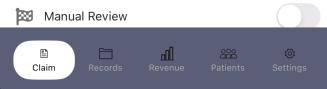
        </Frame>
      </Step>
      <Step title="Enter patient details">
        Enter the patient's **MRN** and demographic details including first name, last name, date of birth, and sex.

        <Frame>
          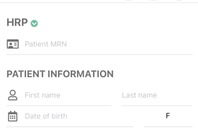
        </Frame>

        <Note>
          For William Osler, select **HRP** as the payment program at the top of the screen.
        </Note>
      </Step>
      <Step title="Confirm service details">
        <Frame>
          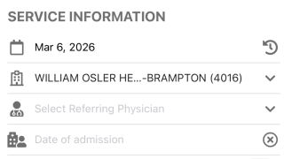
        </Frame>

        Confirm the following service information:
        - **Service date** — defaults to today's date; tap to change
        - **Facility** — select the William Osler facility (e.g., William Osler HE... - Brampton)
        - **Referring physician** — select if applicable
        - **Date of admission** — enter if the service is related to a hospital admission
      </Step>
      <Step title="Add diagnostic code">
        Select the diagnostic code that explains the clinical reason for the service. You can search by code number or description.

        <Frame>
          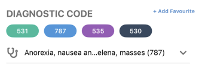
        </Frame>

        <Tip>
          If you don't see the diagnostic codes you need, go to **Settings** and press **Refresh Cache** to update your local data.
        </Tip>
      </Step>
      <Step title="Add billing code">
        Enter the appropriate OHIP billing code and adjust units if required. You can tap **+ Add Billing Code** to add additional service codes to the same claim.

        <Frame>
          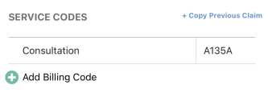
        </Frame>

        Use **+ Copy Previous Claim** to quickly duplicate billing codes from a recent claim.
      </Step>
      <Step title="Submit the claim">
        Review the claim details and the total claimed amount, then tap **Submit Claim**. You can also tap **Save Draft** to save the claim and submit it later.

        <Frame>
          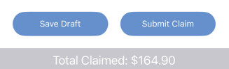
        </Frame>
      </Step>
    </Steps>
  </Tab>
  <Tab title="Web portal">
    <Steps>
      <Step title="Start a new claim">
        Open **Claims** in the left sidebar and click **New Claim** at the top right.

        <Frame>
          
        </Frame>
      </Step>
      <Step title="Select the HRP payment program">
        In **Patient Information**, open the **Payment program** dropdown and choose **Hospital Reimbursement | HRP**. You can type to filter the list.

        The health card field changes to **Patient MRN**, and the OHIP-only **VR** field and **Validate** button disappear — HRP claims are not health-card validated.

        <Frame>
          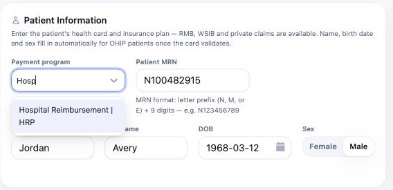
        </Frame>
      </Step>
      <Step title="Enter the patient and service details">
        Enter the **Patient MRN**, then **First name**, **Last name**, **DOB** and **Sex** — none of these fill in automatically for HRP.

        In **Service Information**, set:
        - **Date** — the service date; **Today**, **Yesterday** and **Last claim date** are shortcuts under the field
        - **Facility** — the William Osler site; search by name or by its four-digit facility number
        - **Admission Date** — required for in-patients
        - **Referring Physician** — required for consults

        <Frame>
          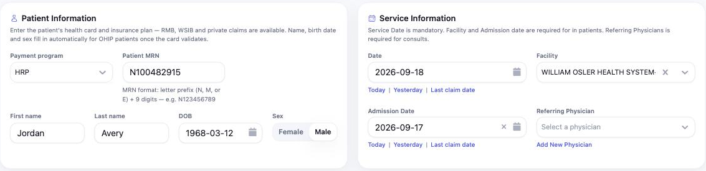
        </Frame>

        <Note>
          The MRN format depends on the service date. For services **before 3 October 2026** the MRN is a letter prefix (**N**, **M** or **E**) plus 9 digits, e.g. `N123456789`. For services **on or after** that date it is 9 digits with no prefix, e.g. `123456789`. The hint under the field always shows the format required for the date you entered.
        </Note>
      </Step>
      <Step title="Add a diagnostic code">
        In **Diagnostic Code**, search by code number or description and pick the code that best represents the patient's diagnosis. Your starred codes are under **Favourites**.

        <Frame>
          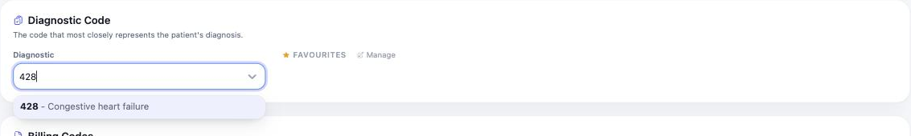
        </Frame>
      </Step>
      <Step title="Add billing codes">
        In **Billing Codes**, search for each service code and select it. The field holds several codes at once, so add every code for the visit before moving on.

        <Frame>
          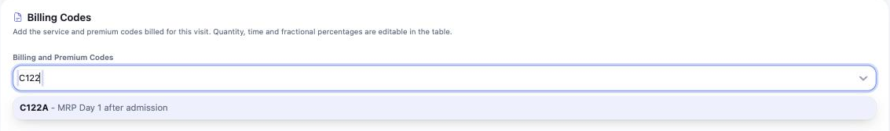
        </Frame>

        Each code you add becomes a row in the table below, where **Modifier** (percentage) and **Units** are editable. **Claim Total** updates as you go, and **Suggested Billing Codes** offers premiums commonly billed with what you've entered.

        <Frame>
          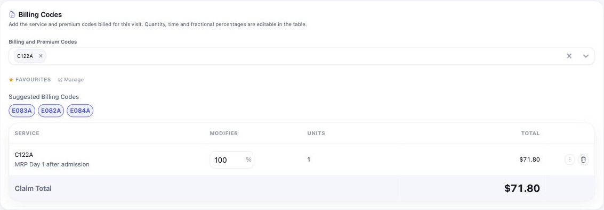
        </Frame>
      </Step>
      <Step title="Submit the claim">
        Check the **Claim Total** in the bar at the bottom of the page, then click **Submit**. **Save as draft** keeps the claim without submitting it, so you can finish it later from the **Draft** filter on the Claims page.

        <Frame>
          
        </Frame>
      </Step>
    </Steps>
  </Tab>
</Tabs>

## After Submission

Once your claim is submitted:
- The claim status will show as **Pending**
- At the end of the billing cycle, accepted claims will move to **Paid** status
- You will receive payment directly from IntelAGENT to the bank account you have set up with William Osler

## Tips

- **Double-check the MRN** — ensure you have the correct patient medical record number before submitting
- **Submit promptly** — you have 60 days from the service date to submit your claim
- **Use drafts** — if you're unsure about any details, save as a draft and complete later
