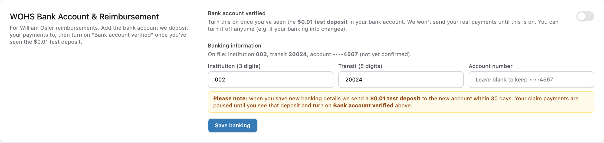
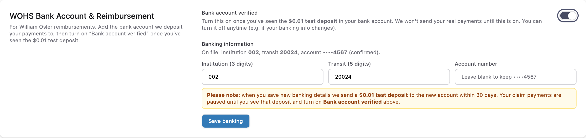
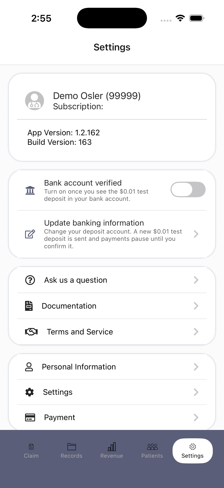
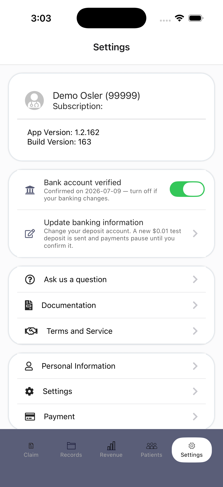

## Overview

Whenever you add or change your bank account, we send a **$0.01 test deposit** to it. Your reimbursements stay **paused** until you see that deposit and turn on **Bank account verified**. This page covers that one step.

<Note>
Haven't entered your bank details yet? Start with [Updating Your Bank Account](/docs/william-osler/bank-account), then come back here.
</Note>

## Before you start

- You saved new banking details on the web portal or mobile app, and they show as **not yet confirmed**.
- The **$0.01 deposit can take up to 30 days to appear** on your statement. Look for a one-cent credit from IntelAGENT.

<Warning>
Only turn on **Bank account verified** after you have actually seen the $0.01 deposit in that account. The toggle tells us it is safe to send real payments there.
</Warning>

## Turning on Bank account verified

You only need to do this in one place — the web portal and the mobile app share the same setting.

<Tabs>
  <Tab title="Desktop (web portal)">
    <Steps>
      <Step title="Check that your account is still unconfirmed">
        Go to **Settings** and find **WOHS Bank Account & Reimbursement**. Under **Banking information** you'll see your account listed as *(not yet confirmed)*, with the **Bank account verified** toggle off.

        <Frame>
          
        </Frame>
      </Step>
      <Step title="Turn on Bank account verified">
        Once the $0.01 deposit appears on your statement, click the **Bank account verified** toggle. Your account now reads *(confirmed)* and your reimbursements are active.

        <Frame>
          
        </Frame>
      </Step>
    </Steps>
  </Tab>
  <Tab title="Mobile app">
    <Steps>
      <Step title="Open Settings">
        Tap the **Settings** tab. The **Bank account verified** toggle is off, and reads *Turn on once you see the $0.01 test deposit in your bank account*.

        <Frame>
          
        </Frame>
      </Step>
      <Step title="Turn on Bank account verified">
        Once the $0.01 deposit appears on your statement, tap the toggle. It turns green and shows the date you confirmed it. Your reimbursements are active.

        <Frame>
          
        </Frame>
      </Step>
    </Steps>
  </Tab>
</Tabs>

## Turning verification off

You can turn **Bank account verified** off at any time — for example, if you're about to close the account or your banking details are changing. While it's off, we hold your payments instead of sending them to an account you're no longer sure about.

If you change your bank account, verification resets on its own: we send a new $0.01 test deposit and you confirm it the same way.

## If the deposit never arrives

<AccordionGroup>
  <Accordion title="It's been less than 30 days">
    Keep waiting — the deposit can take up to 30 days. Leave **Bank account verified** off until you see it. Your claims keep going through in the meantime; only the payout is held.
  </Accordion>
  <Accordion title="It's been more than 30 days">
    Check your **Settings** first and confirm the institution, transit, and account numbers on file are correct. If a digit is wrong, re-enter your details — saving sends a fresh test deposit. If everything looks right, [contact IntelAGENT support](/docs/william-osler/support).
  </Accordion>
  <Accordion title="I turned the toggle on by mistake">
    Turn it back off. Nothing else is needed — payments pause again right away.
  </Accordion>
</AccordionGroup>

## Related

- [Updating Your Bank Account](/docs/william-osler/bank-account) — enter or change your banking details.
- [Remittance & Payment](/docs/william-osler/remittance-payment) — how and when reimbursements are paid.
- [Technical Support](/docs/william-osler/support) — how to reach us.
